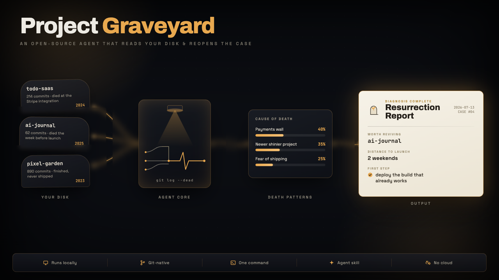
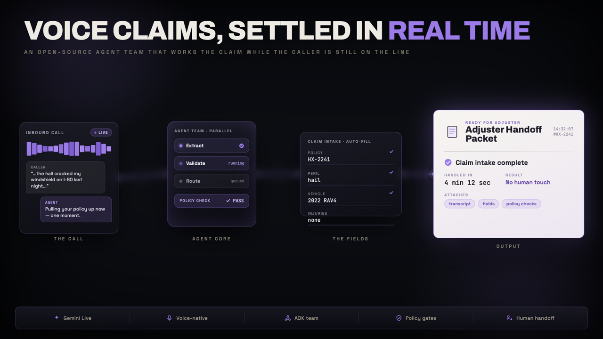
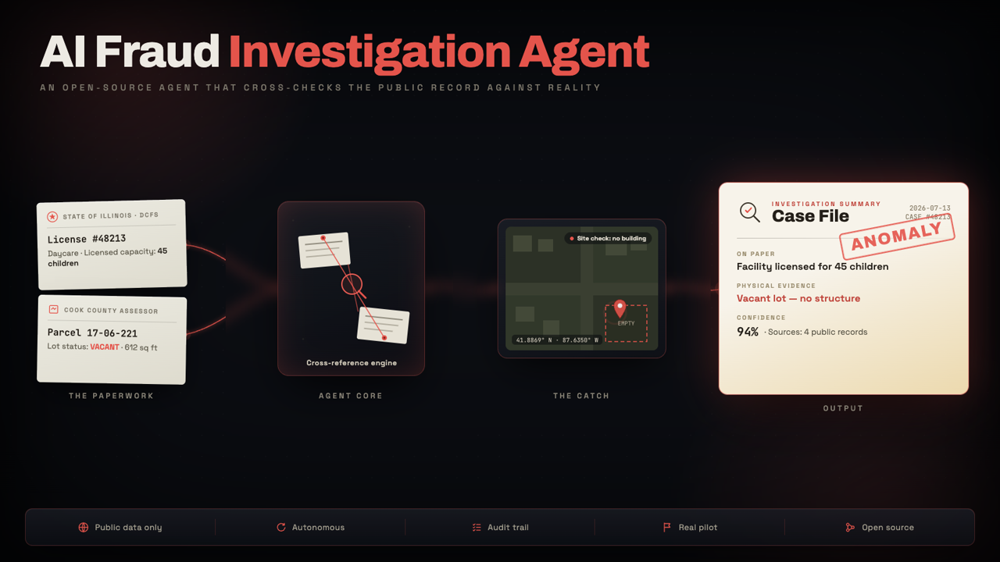
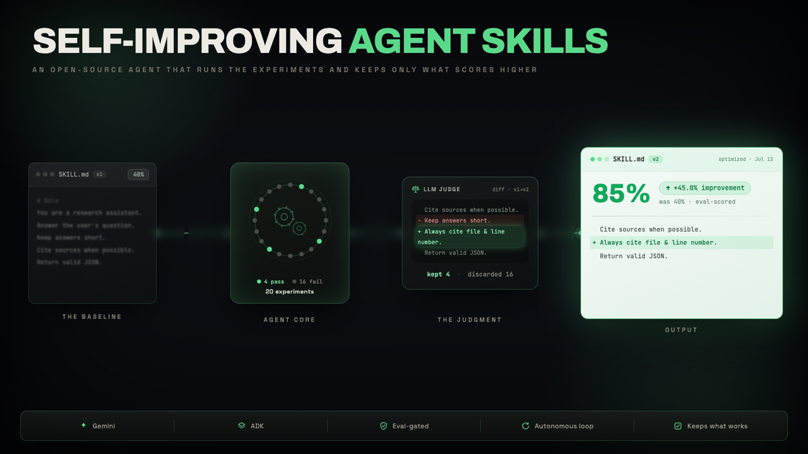
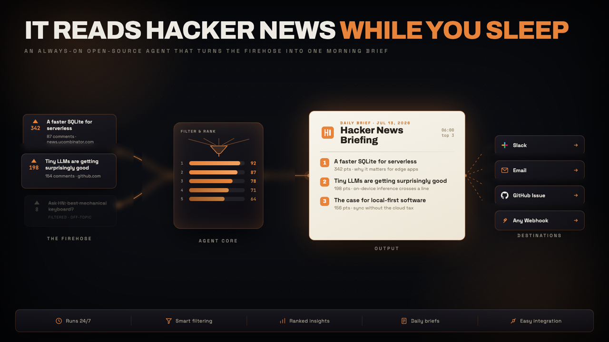

<div align="center">

# Awesome LLM Apps

<p><strong>100+ AI Agent & RAG apps you can actually run: clone, customize, ship.</strong><br/>
AI Agents · Multi-agent Teams · MCP Agents · RAG · Voice Agents · Agent Skills · Fine-tuning</p>

Clone it, ship it, sell it - 100% free and open-source

Works with Claude, Gemini, GPT, DeepSeek, Llama, Qwen and other open-source models.

**[Step-by-step tutorials on Unwind AI](https://www.theunwindai.com)** · **[Quick start](#-run-one-now)** · **[Browse all templates](#-browse-all-templates)**

<p>
<a href="#verified-setup"><kbd> &nbsp; 🚀 Verified Setup &nbsp; </kbd></a>
<a href="#-featured-ai-projects"><kbd> &nbsp; 📂 Browse Templates &nbsp; </kbd></a>
<a href="https://www.theunwindai.com"><kbd> &nbsp; 📚 Step-by-Step Tutorials &nbsp; </kbd></a>
</p>

<a href="https://trendshift.io/repositories/9876" target="_blank">
  
</a>

<br>

</div>

<table>
  <tr>
    <td width="33.3%" align="center">
      <a href="agent_skills/project-graveyard/"></a>
      <sub><b>Project Graveyard</b></sub>
    </td>
    <td width="33.3%" align="center">
      <a href="voice_ai_agents/insurance_claim_live_agent_team/"></a>
      <sub><b>Insurance Claim Live Agent Team</b></sub>
    </td>
    <td width="33.3%" align="center">
      <a href="advanced_ai_agents/single_agent_apps/ai_fraud_investigation_agent/"></a>
      <sub><b>AI Fraud Investigation Agent</b></sub>
    </td>
  </tr>
  <tr>
    <td align="center">
      <a href="agent_skills/self-improving-agent-skills/"></a>
      <sub><b>Self-Improving Agent Skills</b></sub>
    </td>
    <td align="center">
      <a href="advanced_ai_agents/multi_agent_apps/ai_home_renovation_agent"></a>
      <sub><b>AI Home Renovation Agent</b></sub>
    </td>
    <td align="center">
      <a href="always_on_agents/always_on_hn_briefing_agent/"></a>
      <sub><b>Always-on HN Briefing Agent</b></sub>
    </td>
  </tr>
</table>

## Why this fork exists

This fork is **Alexi5000’s applied agent-engineering reference library**, maintained by Alex Cinovoj, Founder & CTO of TechTide AI. It is a practical review surface for the workflows Alex has developed across more than a year of agent building, automation design, and hands-on work with Cursor, Claude, Codex-class coding agents, MCP integrations, retrieval systems, and multi-agent orchestration.

**What it does.** The repository keeps the upstream catalog of runnable LLM, agent, MCP, RAG, and voice examples, each with its own `requirements.txt`, and adds a root-level quality contract: `tests/` holds catalog contract tests plus upload, calculator, external-content, and network/media security regressions, and `.github/workflows/` runs those tests, compiles every Python example, and exercises fifteen per-example runtime workflows on the examples that have been patched in this fork.

**Who it serves.** Agent builders, automation engineers, AI-assisted developers, and reviewers who want to compare working patterns (tools, MCP, routing, RAG, memory, multi-agent teams) and check an example's dependency state and safety boundaries before adapting it to a real product. It is a reference collection, not a claim that every example is production-ready for every environment.

**Why Alex forked it.** The fork was created on 2025-10-20 (GitHub `created_at`). In May 2026 it staged three upstream pull requests to Shubhamsaboo/awesome-llm-apps: [#830](https://github.com/Shubhamsaboo/awesome-llm-apps/pull/830) (remove stdlib modules from `requirements.txt`, merged 2026-05-21), [#829](https://github.com/Shubhamsaboo/awesome-llm-apps/pull/829) (CONTRIBUTING checklist, closed), and [#831](https://github.com/Shubhamsaboo/awesome-llm-apps/pull/831) (sidebar API-key input instead of hardcoded placeholders, closed); their source branches are retained here as `pr/*`. The first fork-only commit on `main` (`fa0ac1a`, 2026-08-17, "docs: establish agent engineering fork standards") added [FORK_POLICY.md](./FORK_POLICY.md), which records the purpose: an applied agent-engineering fork that "preserves upstream credit and Apache-2.0 licensing while adding Alexi5000-specific documentation, quality gates, and review guidance for agent-building and automation practice". Commits `933ca61` and `934e945` (2026-08-17) added the catalog quality workflow on Python 3.12, and the October 2026 series (#1 to #42, 2026-10-18 to 2026-10-20) patched vulnerable example dependencies and added security regressions for upload paths, rendered content, link hosts, and arithmetic evaluation.

**Real-world use case (2025–2026 evidence).** **Verified in this repository.** A reviewer picks a catalog example (for instance the legal document RAG or a Streamlit single-file agent), confirms that user-supplied filenames cannot escape the example's temporary directory, and only then adapts it with their own corpus and credentials. The checks that back this scenario run in the `Quality` workflow on every push and pull request: `tests/test_legal_upload_security.py`, `tests/test_rag_upload_security.py`, `tests/test_calculator_security.py`, `tests/test_external_content_security.py`, and `tests/test_network_and_media_security.py` (30 tests, passing on `main` at `2a9d2af`, 2026-10-20). The surrounding ecosystem moved quickly in 2025 and 2026: the MCP specification that the `mcp_ai_agents` examples target was revised on 2025-06-18[^1]; Streamlit, used by most single-file examples here, shipped 1.66.0 on 2026-10-14[^2]; and NLTK, pinned by the Beifong example, published advisory GHSA-8mgp-746c-j5xp in September 2026[^3] followed by a 3.10.4 release on 2026-10-21 that describes a path sandbox for data and model files[^4]. No model provider, browser agent, or external action is executed by these tests.

[^1]: Model Context Protocol, "Specification 2025-06-18", published 2025-06-18. https://modelcontextprotocol.io/specification/2025-06-18
[^2]: Streamlit, "1.66.0" release notes, published 2026-10-14. https://github.com/streamlit/streamlit/releases/tag/1.66.0
[^3]: GitHub Advisory Database, "GHSA-8mgp-746c-j5xp: NLTK model-artifact APIs bypass pathsec", published 2026-09-02. https://github.com/advisories/GHSA-8mgp-746c-j5xp
[^4]: NLTK, "v3.10.4" release notes, published 2026-10-21. https://github.com/nltk/nltk/releases/tag/v3.10.4

| This fork is for | How to use it |
|---|---|
| **Agent builders** | Compare patterns for tools, MCP, routing, RAG, memory, and multi-agent workflows before adapting one to a real product. |
| **Automation engineers** | Evaluate integration boundaries, credentials handling, reviewability, and operational fit before connecting external systems. |
| **AI-assisted developers** | Use the examples as structured prompts and implementation references with Cursor, Claude, Codex-class assistants, or comparable coding environments. |
| **Reviewers and contributors** | Propose focused improvements that preserve upstream attribution while raising reproducibility and documentation quality. |

## Upstream

- Upstream project: [Shubhamsaboo/awesome-llm-apps](https://github.com/Shubhamsaboo/awesome-llm-apps), licensed under [Apache-2.0](LICENSE). The upstream catalog, its authors, and its contributors retain full credit for their work; the license file is preserved unchanged and nothing in this fork is relicensed.
- Fork created: 2025-10-20. Default branch: `main`.
- Upstream synchronization: integrated upstream `main` as of 2026-10-24 while retaining fork documentation, dependency repairs, and security regression tests. See [FORK_POLICY.md](./FORK_POLICY.md) for the synchronization discipline.
- Fork-specific documentation and quality controls are maintained by Alex Cinovoj (GitHub `Alexi5000`) and should not be represented as upstream changes unless separately contributed and accepted upstream.

**What this fork preserves across upstream updates:**

- Fork standards and policy files: `FORK_POLICY.md`, `SECURITY.md`, `SUPPORT.md`, `CONTRIBUTING.md`, the fork sections of this README, and `tests/test_repository_contract.py` (`fa0ac1a`, `e00b2a7`).
- CI: the root `Quality` workflow (contract tests plus `compileall` on Python 3.12) and fifteen per-example runtime workflows (AQI, Beifong, memory, negotiation frontend, RAG loaders, recruitment, routing, startup trends, teaching, visualisation, voice/math, Windows agent, and others).
- Dependency repairs across patched examples: Streamlit, Requests, python-dotenv, LangChain and LangGraph, Qdrant, Agno, Mem0, Composio, Next.js and React, Electron, PostCSS, aiohttp/yarl, and image codec updates (#1 to #37, #41).
- Security regressions and fixes in example code: bounded calculator evaluation (#38), confined legal-document and RAG upload paths (#39, #40), sanitized rendered content and validated link hosts (#35), pinned URL ingestion and confined media downloads (#34), and fail-closed AQI fetching (#17).

## 🚀 Run one now

Give your coding agent a new skill in 10 seconds:

```bash
npx skills add https://github.com/Shubhamsaboo/awesome-llm-apps/tree/main/agent_skills/project-graveyard
```

Then ask it: *"why do I never finish my side projects?"*

> ⭐ **If this saves you time, [star the repo](https://github.com/Shubhamsaboo/awesome-llm-apps/stargazers) - that's how the next developer discovers it.**

## Verified setup

Use Python 3.12 or newer. Each example owns its dependencies, so install only the requirements for the project you are evaluating. The following path starts the travel-agent example in an isolated virtual environment.

```bash
git clone https://github.com/Alexi5000/awesome-llm-apps.git
cd awesome-llm-apps
python3 -m venv .venv
source .venv/bin/activate

cd starter_ai_agents/ai_travel_agent
python -m pip install --upgrade pip
python -m pip install -r requirements.txt
streamlit run travel_agent.py
```

Before opening a pull request, validate the collection’s repository contract from the repository root:

```bash
python3 -m unittest discover -s tests -p "test_*.py"
python3 -m compileall -q \
  starter_ai_agents advanced_ai_agents advanced_llm_apps \
  mcp_ai_agents rag_tutorials voice_ai_agents
```

## Use cases

| Goal | Starting point |
|---|---|
| Learn an agent loop or tool pattern | Browse [`starter_ai_agents`](./starter_ai_agents) and progress to [`advanced_ai_agents`](./advanced_ai_agents). |
| Prototype a tool-connected workflow | Review [`mcp_ai_agents`](./mcp_ai_agents) alongside the provider-specific README and requirements for the selected example. |
| Design an evidence-grounded retrieval flow | Explore [`rag_tutorials`](./rag_tutorials), then adapt a single project with your own corpus, evaluation data, and access controls. |
| Build a voice or multimodal experience | Start with [`voice_ai_agents`](./voice_ai_agents) or the multimodal examples in the advanced collection. |
| Compare framework trade-offs | Use [`ai_agent_framework_crash_course`](./ai_agent_framework_crash_course) as a learning reference before choosing a production dependency. |


## 📂 Browse all templates

### 🧩 Agent Skills

*Give your coding agent new abilities. One command to install, plain English to use. Every skill ships real code and passes a security + eval CI gate. Works with Claude Code, Codex, Cursor, and other coding agents. [Browse all skills →](agent_skills/)*

*   [⚰️ Project Graveyard](agent_skills/project-graveyard/) - Finds every side project you abandoned, tells you why each one died, and helps you finish the one worth going back to
*   [👁️ First Reader](agent_skills/first-reader/) - Simulates real readers going through your draft and reports where they lose interest, where they stop reading, and what they remember afterward, without rewriting a word
*   [🔭 Scope Creep Detector](agent_skills/scope-creep-detector/) - Checks whether a diff grew beyond its stated intent and recommends what to keep, split, or justify
*   [🏺 Commit Archaeologist](agent_skills/commit-archaeologist/) - Reconstructs why a file or code region exists from its introducing commit, later edits, co-changes, and intent clues
*   [🩺 Dependency Doctor](agent_skills/dependency-doctor/) - Checks a dependency manifest for standard-library pins, obsolete backports, unpinned entries, duplicate constraints, and yanked releases
*   [🧠 Advisor Orchestrator Worker](agent_skills/advisor-orchestrator-worker/) - Meta Loop with Claude Fable 5.1 as advisor, GPT-6 Astra as orchestrator, and Gemini 3.8 Flash as worker
*   [🎙️ Thinking Out Loud](agent_skills/thinking-out-loud/) - Echoes a voice ramble back as a scannable brief, with the model's guesses quarantined and your reversals flagged
*   [♾️ Self-Improving Agent Skills](agent_skills/self-improving-agent-skills/) - Automatically optimize agent skills using Gemini and ADK

### 🛠️ Standalone Apps & Tools

*Standalone web apps, creative tools, and browser extensions for everyday workflows.*

*   [✏️ Excaliflow - Hand-Drawn Diagrams with Live Animated Flows](advanced_llm_apps/excaliflow/) - Sketch system architectures and AI agent workflows on an Excalidraw-style canvas with live animated arrows and video export
*   [🪡 Needle - A New Way to Find](advanced_llm_apps/needle/) - Search webpages by meaning and highlight the strongest source sentence, using a Chrome extension powered by TypeSafe Jev
*   [🌀 Ripple - Change One Thing, Find What Else Needs to Change](advanced_llm_apps/ripple/) - Find related inconsistencies and suggested fixes as you edit a Google Doc, using TypeSafe Jev and Gemini

### 🌱 Starter AI Agents

*Single-file agents that run with just an API key - a great place to start.*

*   [🎙️ AI Blog to Podcast Agent](starter_ai_agents/ai_blog_to_podcast_agent/)
*   [❤️‍🩹 AI Breakup Recovery Agent](starter_ai_agents/ai_breakup_recovery_agent/)
*   [📊 AI Data Analysis Agent](starter_ai_agents/ai_data_analysis_agent/)
*   [🩻 AI Medical Imaging Agent](starter_ai_agents/ai_medical_imaging_agent/)
*   [😂 AI Meme Generator Agent (Browser)](starter_ai_agents/ai_meme_generator_agent_browseruse/)
*   [🎵 AI Music Generator Agent](starter_ai_agents/ai_music_generator_agent/)
*   [🛫 AI Travel Agent (Local & Cloud)](starter_ai_agents/ai_travel_agent/)
*   [🔄 Mixture of Agents](starter_ai_agents/mixture_of_agents/)
*   [📊 xAI Finance Agent](starter_ai_agents/xai_finance_agent/)
*   [🔍 OpenAI Research Agent](starter_ai_agents/openai_research_agent/)
*   [🕸️ Web Scraping AI Agent (Local & Cloud SDK)](starter_ai_agents/web_scraping_ai_agent/)

### 🚀 Advanced AI Agents

*Production-style agents with tools, memory, and multi-step reasoning.*

*   [🏚️ 🍌 AI Home Renovation Agent with Nano Banana Pro](advanced_ai_agents/multi_agent_apps/ai_home_renovation_agent) - Photos of your space in, renovation plan and photorealistic renders out
*   [🧠 DevPulse AI - Multi-Agent Signal Intelligence](advanced_ai_agents/multi_agent_apps/devpulse_ai/) - Aggregates and scores technical signals into a daily intelligence digest
*   [🔍 AI Deep Research Agent](advanced_ai_agents/single_agent_apps/ai_deep_research_agent/) - Comprehensive web research with the OpenAI Agents SDK and Firecrawl
*   [📊 AI VC Due Diligence Agent Team](advanced_ai_agents/multi_agent_apps/agent_teams/ai_vc_due_diligence_agent_team) - Multi-agent startup investment analysis with Gemini 3
*   [🔬 AI Research Planner & Executor (Google Interactions API)](advanced_ai_agents/single_agent_apps/research_agent_gemini_interaction_api) - Multi-phase research with stateful conversations and auto-generated infographics
*   [🤝 AI Consultant Agent](advanced_ai_agents/single_agent_apps/ai_consultant_agent) - Market analysis and strategy recommendations with live web research
*   [🏗️ AI System Architect Agent](advanced_ai_agents/single_agent_apps/ai_system_architect_r1/) - Architecture reviews using DeepSeek R1 reasoning plus Claude
*   [💰 AI Financial Coach Agent](advanced_ai_agents/multi_agent_apps/ai_financial_coach_agent/) - Personalized budget, debt, and savings analysis
*   [🎬 AI Movie Production Agent](advanced_ai_agents/single_agent_apps/ai_movie_production_agent/) - Script drafts and casting ideas from a one-line movie concept
*   [📈 AI Investment Agent](advanced_ai_agents/single_agent_apps/ai_investment_agent/) - Stock comparison reports built on Yahoo Finance data
*   [📡 Earnings Call Analyst Agent](advanced_ai_agents/single_agent_apps/earnings_call_analyst_agent/) - Turns YouTube earnings calls into a playback-synced analyst workspace
*   [🏋️‍♂️ AI Health & Fitness Agent](advanced_ai_agents/single_agent_apps/ai_health_fitness_agent/) - Tailored diet and workout plans from your goals
*   [🚀 AI Product Launch Intelligence Agent](advanced_ai_agents/multi_agent_apps/product_launch_intelligence_agent) - Go-to-market intelligence on competitor launches
*   [🔍 AI Fraud Investigation Agent](advanced_ai_agents/single_agent_apps/ai_fraud_investigation_agent/) - Cross-references public records to flag facilities that don't add up
*   [🗞️ AI Journalist Agent](advanced_ai_agents/single_agent_apps/ai_journalist_agent/) - Researches, writes, and edits articles on any topic
*   [🧠 AI Mental Wellbeing Agent](advanced_ai_agents/multi_agent_apps/ai_mental_wellbeing_agent/) - A coordinated agent team for mental health support plans
*   [📑 AI Meeting Agent](advanced_ai_agents/single_agent_apps/ai_meeting_agent/) - Context, industry insights, and strategy briefs before you walk in
*   [🧬 AI Self-Evolving Agent](advanced_ai_agents/multi_agent_apps/ai_self_evolving_agent/) - Agents that rewrite their own workflows with EvoAgentX
*   [👨🏻‍💼 AI Sales Intelligence Agent Team](advanced_ai_agents/multi_agent_apps/agent_teams/ai_sales_intelligence_agent_team) - Generates competitive sales battle cards in real time
*   [🎧 AI Social Media News and Podcast Agent](advanced_ai_agents/multi_agent_apps/ai_news_and_podcast_agents/) - Curates your trusted sources into briefs and generated podcasts
*   [🌐 Openwork - Open Browser Automation Agent](https://github.com/accomplish-ai/coworker) <sub>↗ external</sub> - Open-source agent that operates a real browser
*   [🛡️ Trust-Gated Multi-Agent Research Team](advanced_ai_agents/multi_agent_apps/trust_gated_agent_team/) - Every agent verified, every action in a hash-chained audit trail

### 🛰️ Always-on Agents

*Background agents that run on schedules or events, monitor changing context, decide what needs attention, and proactively deliver updates, artifacts, or actions.*

*   [📰 Always-on Hacker News Briefing Agent](always_on_agents/always_on_hn_briefing_agent/) - A scheduled scout that ships a ranked daily brief to Slack or email
*   [📡 Release Radar Agent](always_on_agents/release_radar_agent/) - Watches dependency releases and briefs you on breaking, deprecated, security, and major-version changes

### 🤝 Multi-agent Teams

*Multiple agents collaborating to accomplish complex, cross-domain tasks.*

*   [🧲 AI Competitor Intelligence Agent Team](advanced_ai_agents/multi_agent_apps/agent_teams/ai_competitor_intelligence_agent_team/) - Structured competitor teardowns built from their own websites
*   [💲 AI Finance Agent Team](advanced_ai_agents/multi_agent_apps/agent_teams/ai_finance_agent_team/) - A financial analyst team in 20 lines of Python
*   [🎨 AI Game Design Agent Team](advanced_ai_agents/multi_agent_apps/agent_teams/ai_game_design_agent_team/) - Full game concepts from a swarm of design specialists
*   [🧭 AG2 Adaptive Research Team](advanced_ai_agents/multi_agent_apps/agent_teams/ag2_adaptive_research_team/) - Agent teamwork with routing and fallback, built on AG2
*   [👨‍⚖️ AI Legal Agent Team (Cloud & Local)](advanced_ai_agents/multi_agent_apps/agent_teams/ai_legal_agent_team/) - Research, contract analysis, and strategy from a full legal bench
*   [💼 AI Recruitment Agent Team](advanced_ai_agents/multi_agent_apps/agent_teams/ai_recruitment_agent_team/) - Resume screening to interview scheduling, end to end
*   [🏠 AI Real Estate Agent Team](advanced_ai_agents/multi_agent_apps/agent_teams/ai_real_estate_agent_team) - Property search, market analysis, and recommendations
*   [👨‍💼 AI Services Agency (CrewAI)](advanced_ai_agents/multi_agent_apps/agent_teams/ai_services_agency/) - A digital agency that scopes and plans your software project
*   [👨‍🏫 AI Teaching Agent Team](advanced_ai_agents/multi_agent_apps/agent_teams/ai_teaching_agent_team/) - A faculty of agents that builds your complete learning path
*   [💻 Multimodal Coding Agent Team](advanced_ai_agents/multi_agent_apps/agent_teams/multimodal_coding_agent_team/) - Snap a photo of a coding problem, get a sandboxed solution
*   [✨ Multimodal Design Agent Team](advanced_ai_agents/multi_agent_apps/agent_teams/multimodal_design_agent_team/) - Design critiques from a Gemini-powered expert panel
*   [🎨 🍌 Multimodal UI/UX Feedback Agent Team](advanced_ai_agents/multi_agent_apps/agent_teams/multimodal_uiux_feedback_agent_team/) - Landing page feedback plus an auto-generated improved version
*   [🌏 AI Travel Planner Agent Team](advanced_ai_agents/multi_agent_apps/agent_teams/ai_travel_planner_agent_team/) - A complete trip itinerary, crafted by a team
*   [⚖️ LLM Panel Agent Team](advanced_ai_agents/multi_agent_apps/agent_teams/llm_panel_agent_team/) - Three vendors review the same diff blind, then argue it out anonymously

### 🗣️ Voice AI Agents

*Speech-in, speech-out agents using real-time voice APIs.*

*   [🗣️ AI Audio Tour Agent](voice_ai_agents/ai_audio_tour_agent/) - Self-guided audio tours from your location, interests, and pace
*   [📞 Customer Support Voice Agent](voice_ai_agents/customer_support_voice_agent/) - Voice answers grounded in your own docs
*   [🛡️ Insurance Claim Live Agent Team](voice_ai_agents/insurance_claim_live_agent_team/) - Voice claim intake on Gemini 3.8 Live that writes a field notebook, looks at damage through the webcam, and sketches the incident
*   [🔊 Voice RAG Agent (OpenAI SDK)](voice_ai_agents/voice_rag_openaisdk/) - Ask your PDFs questions, hear the answers
*   [🎙️ OpenSource Voice Dictation Agent (Wispr Flow clone)](https://github.com/akshayaggarwal99/jarvis-ai-assistant) <sub>↗ external</sub> - Open-source dictation that types where you talk

### 🖼️ Generative UI and Agentic Frontends

*Agents that render interactive UI components, not just text: forms, cards, charts, editable plans.*

*   [🗂️ Generative UI Starter Project](generative_ui_agents/generative-ui-starter-project/) - A chat-driven kanban board you and the agent work together
*   [🪙 AI Financial Coach Agent](generative_ui_agents/ai-financial-coach-agent/) - Budget, savings, and debt plans rendered as interactive cards
*   [📊 AI Dashboard Canvas Agent](generative_ui_agents/ai-dashboard-canvas-agent/) - Describe a dashboard in chat, charts assemble on a live canvas
*   [🛠️ AI MCP App Builder](generative_ui_agents/ai-mcp-app-builder/) - Describe an MCP app, get a live sandboxed instance back
*   [✈️ MCP Apps Generative UI Showcase](generative_ui_agents/mcp-apps-generative-ui-showcase/) - MCP apps that render real interactive UI, flight search included
*   [🎛️ AI Shadcn Component Generator](generative_ui_agents/ai-shadcn-component-generator/) - Chat your way to production-ready shadcn components
*   [🔍 AI Deep Research Agent](generative_ui_agents/ai-deep-research-agent/) - Research where every tool call renders as a live workspace card

### 🎮 Autonomous Game-Playing Agents

*Agents that play games end-to-end: reasoning, strategy, and action.*

*   [🎮 AI 3D Pygame Agent](advanced_ai_agents/autonomous_game_playing_agent_apps/ai_3dpygame_r1/) - DeepSeek R1 writes PyGame code, browser agents run it live
*   [♜ AI Chess Agent](advanced_ai_agents/autonomous_game_playing_agent_apps/ai_chess_agent/) - Agent White vs Agent Black with validated moves
*   [🎲 AI Tic-Tac-Toe Agent](advanced_ai_agents/autonomous_game_playing_agent_apps/ai_tic_tac_toe_agent/) - Two different LLMs battle it out, move by move

### ♾️ MCP AI Agents

*Agents that connect to external tools and data via Model Context Protocol.*

*   [♾️ Browser MCP Agent](mcp_ai_agents/browser_mcp_agent/) - Drive a real browser with natural language over MCP
*   [🐙 GitHub MCP Agent](mcp_ai_agents/github_mcp_agent/) - Explore and analyze any repo in plain English
*   [📑 Notion MCP Agent](mcp_ai_agents/notion_mcp_agent) - Talk to your Notion pages from the terminal
*   [🌍 AI Travel Planner MCP Agent](mcp_ai_agents/ai_travel_planner_mcp_agent_team) - Itineraries built on live Airbnb and Google Maps data
*   [🔀 Multi-MCP Agent Router](mcp_ai_agents/multi_mcp_agent_router/) - Specialist agents, each wired to its own MCP server
*   [🔌 OpenAI Remote MCP Tool Bridge](mcp_ai_agents/openai_remote_mcp_bridge/) - Connect OpenAI function calling directly to a remote MCP server

### 📀 RAG (Retrieval Augmented Generation)

*Retrieval pipelines, from simple chains to agentic and multi-source.*

*   [🔥 Agentic RAG with Embedding Gemma](rag_tutorials/agentic_rag_embedding_gemma) - Fully local agentic RAG with EmbeddingGemma and Llama 3.2
*   [🧐 Agentic RAG with Reasoning](rag_tutorials/agentic_rag_with_reasoning/) - Watch the agent's step-by-step reasoning as it retrieves
*   [📰 AI Blog Search (RAG)](rag_tutorials/ai_blog_search/) - Agentic search over blog content, built on LangGraph
*   [🔍 Autonomous RAG](rag_tutorials/autonomous_rag/) - GPT-4o answers from your PDFs, falls back to web search
*   [🔄 Contextual AI RAG Agent](rag_tutorials/contextualai_rag_agent/) - Managed RAG: datastore to grounded chat in minutes
*   [🔄 Corrective RAG (CRAG)](rag_tutorials/corrective_rag/) - Retrieval that grades itself and retries before answering
*   [📎 Typed Agentic RAG with Pydantic AI](rag_tutorials/agentic_typed_rag_pydanticai/) - Validated answers with exact citations, or a refusal when evidence is weak
*   [🐋 Deepseek Local RAG Agent](rag_tutorials/deepseek_local_rag_agent/) - Local DeepSeek reasoning over your own documents
*   [🤔 Gemini Agentic RAG](rag_tutorials/gemini_agentic_rag/) - Query rewriting and web fallback with Gemini Flash Thinking
*   [👀 Hybrid Search RAG (Cloud)](rag_tutorials/hybrid_search_rag/) - Keyword plus vector search feeding Claude
*   [🔄 Llama 3.1 Local RAG](rag_tutorials/llama3.1_local_rag/) - Chat with any webpage, fully offline
*   [🖥️ Local Hybrid Search RAG](rag_tutorials/local_hybrid_search_rag/) - Hybrid search with everything running on your machine
*   [🧬 Multimodal Agentic RAG](rag_tutorials/multimodal_agentic_rag/) - Text, PDFs, images, audio, and video, answered with citations
*   [🦙 Local RAG Agent](rag_tutorials/local_rag_agent/) - Llama 3.2 and Qdrant, no API keys required
*   [🧩 RAG-as-a-Service](rag_tutorials/rag-as-a-service/) - A production RAG service in under 50 lines
*   [✨ RAG Agent with Cohere](rag_tutorials/rag_agent_cohere/) - Command R7B retrieval with web-search fallback
*   [⛓️ Basic RAG Chain](rag_tutorials/rag_chain/) - The minimal retrieval pipeline, applied to pharma research
*   [📠 RAG with Database Routing](rag_tutorials/rag_database_routing/) - Routes each question to the right database automatically
*   [🖼️ Vision RAG](rag_tutorials/vision_rag/) - Ask questions about images and PDF pages with Embed-4
*   [🩺 RAG Failure Diagnostics Clinic](rag_tutorials/rag_failure_diagnostics_clinic/) - Find out why your RAG pipeline is wrong, systematically
*   [🕸️ Knowledge Graph RAG with Citations](rag_tutorials/knowledge_graph_rag_citations/) - Multi-hop answers with verifiable source attribution

### 💾 LLM Apps with Memory

*Agents and chatbots that remember conversations and user state across sessions.*

*   [💾 AI ArXiv Agent with Memory](advanced_llm_apps/llm_apps_with_memory_tutorials/ai_arxiv_agent_memory/) - Paper search that remembers your research interests
*   [🛩️ AI Travel Agent with Memory](advanced_llm_apps/llm_apps_with_memory_tutorials/ai_travel_agent_memory/) - A travel assistant that remembers your preferences
*   [💬 Llama3 Stateful Chat](advanced_llm_apps/llm_apps_with_memory_tutorials/llama3_stateful_chat/) - Session-persistent chat with Llama 3
*   [📝 LLM App with Personalized Memory](advanced_llm_apps/llm_apps_with_memory_tutorials/llm_app_personalized_memory/) - A chatbot that keeps context across conversations
*   [🗄️ Local ChatGPT Clone with Memory](advanced_llm_apps/llm_apps_with_memory_tutorials/local_chatgpt_with_memory/) - Fully local, with a personal memory per user
*   [🧠 Multi-LLM Application with Shared Memory](advanced_llm_apps/llm_apps_with_memory_tutorials/multi_llm_memory/) - Different models, one shared conversation memory

### 💬 Chat with X

*Turn any data source into a chat interface.*

*   [💬 Chat with GitHub (GPT & Llama3)](advanced_llm_apps/chat_with_X_tutorials/chat_with_github/) - Any repo, answered in 30 lines of RAG
*   [📨 Chat with Gmail](advanced_llm_apps/chat_with_X_tutorials/chat_with_gmail/) - Ask your inbox questions
*   [📄 Chat with PDF (GPT & Llama3)](advanced_llm_apps/chat_with_X_tutorials/chat_with_pdf/) - The classic, in 30 lines of Python
*   [📚 Chat with Research Papers (ArXiv) (GPT & Llama3)](advanced_llm_apps/chat_with_X_tutorials/chat_with_research_papers/) - Explore arXiv conversationally with GPT-4o
*   [📝 Chat with Substack](advanced_llm_apps/chat_with_X_tutorials/chat_with_substack/) - Chat with any newsletter's archive
*   [📽️ Chat with YouTube Videos](advanced_llm_apps/chat_with_X_tutorials/chat_with_youtube_videos/) - Ask videos questions via their transcripts

### 🎯 LLM Optimization Tools

*Reduce token usage, context size, and API cost without losing quality.*

*   [🎯 Toonify Token Optimization](advanced_llm_apps/llm_optimization_tools/toonify_token_optimization/) - Reduce LLM API costs by 30-60% using TOON format
*   [🧠 Headroom Context Optimization](advanced_llm_apps/llm_optimization_tools/headroom_context_optimization/) - Reduce LLM API costs by 50-90%

### 🔧 LLM Fine-tuning

*End-to-end fine-tuning recipes for open-source models.*

*   [🦥 Gemma 3 Fine-tuning](advanced_llm_apps/llm_finetuning_tutorials/gemma3_finetuning/) - 4-bit LoRA with Unsloth, small and readable
*   [🦙 Llama 3.2 Fine-tuning](advanced_llm_apps/llm_finetuning_tutorials/llama3.2_finetuning/) - Fine-tune in 30 lines, free on Colab

### 🧑‍🏫 AI Agent Framework Crash Courses

*Deep-dive tutorials on the major agent frameworks.*

*   [Google ADK Crash Course](ai_agent_framework_crash_course/google_adk_crash_course/) - Starter agent, structured outputs, tools (built-in, function, third-party, MCP), memory, callbacks, plugins, and multi-agent patterns. Model-agnostic.
*   [OpenAI Agents SDK Crash Course](ai_agent_framework_crash_course/openai_sdk_crash_course/) - Starter agent, function calling, structured outputs, tools, memory, evaluation, handoffs, swarm orchestration, and routing logic.

---

<div align="center">

## Security

- Open Dependabot alerts at 2026-10-21: 1. `nltk==3.10.3` in `advanced_ai_agents/multi_agent_apps/ai_news_and_podcast_agents/beifong/requirements.txt` is affected by [GHSA-8mgp-746c-j5xp](https://github.com/advisories/GHSA-8mgp-746c-j5xp) (high; model-artifact APIs bypass `pathsec`), a known upstream advisory with no fixed release as of 2026-10-20. NLTK 3.10.4 was published on 2026-10-21 with sandboxing changes, but the advisory had not been updated with a patched version when this README was written, so the pin is unchanged and the alert is left open rather than dismissed.
- That requirement is scoped to the Beifong example. The root `Quality` workflow installs only `fastapi` and never installs example requirements; the `Beifong dependency runtime` workflow installs them in a disposable virtual environment on CI only.
- Mitigation already in this repository: none specific to this advisory beyond the example-scoped install. Treat Beifong's NLTK model and data downloads as untrusted input and run the example in an isolated environment.
- Report vulnerabilities privately as described in [SECURITY.md](./SECURITY.md).

## Support and contribution path

Use [GitHub Issues](https://github.com/Alexi5000/awesome-llm-apps/issues) for reproducible documentation defects, broken catalog paths, or focused discussion of a fork-specific improvement. For contribution expectations, security reporting, conduct standards, and the upstream-sync policy, read [CONTRIBUTING.md](./CONTRIBUTING.md), [SECURITY.md](./SECURITY.md), [CODE_OF_CONDUCT.md](./CODE_OF_CONDUCT.md), [SUPPORT.md](./SUPPORT.md), and [FORK_POLICY.md](./FORK_POLICY.md).

Do not place API keys, OAuth tokens, private datasets, customer information, or unreported vulnerabilities in issues or pull requests. Every agent example should be reviewed against the provider’s current documentation and your own security, privacy, and deployment requirements before use.

## 🙏 Built by

<sub>
<!-- Keep these links. Translations will automatically update with the README. -->
<a href="https://www.readme-i18n.com/Shubhamsaboo/awesome-llm-apps?lang=de">Deutsch</a> ·
<a href="https://www.readme-i18n.com/Shubhamsaboo/awesome-llm-apps?lang=es">Español</a> ·
<a href="https://www.readme-i18n.com/Shubhamsaboo/awesome-llm-apps?lang=fr">français</a> ·
<a href="https://www.readme-i18n.com/Shubhamsaboo/awesome-llm-apps?lang=ja">日本語</a> ·
<a href="https://www.readme-i18n.com/Shubhamsaboo/awesome-llm-apps?lang=ko">한국어</a> ·
<a href="https://www.readme-i18n.com/Shubhamsaboo/awesome-llm-apps?lang=pt">Português</a> ·
<a href="https://www.readme-i18n.com/Shubhamsaboo/awesome-llm-apps?lang=ru">Русский</a> ·
<a href="https://www.readme-i18n.com/Shubhamsaboo/awesome-llm-apps?lang=zh">中文</a>
</sub>

<sub>Apache-2.0 · See <a href="LICENSE">LICENSE</a> · Fork it, ship it, sell it.</sub>

</div>
